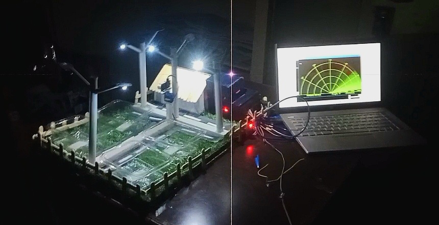

# Krishi Mitra — Autonomous Edge-IoT Agritech Telemetry System
**Developed by Team AgriTech Wizards**

An autonomous edge-to-cloud agricultural telemetry and closed-loop actuation platform engineered to optimize water consumption, monitor micro-climates, and deliver data-driven advisory metrics to smallholder farmers.

---

## Benchmark Performance & Impact Metrics

* **-40% Water Consumption:** Precision irrigation scheduling driven by capacitive soil moisture and tank depth feedback.
* **-28% Operating Costs:** Automated valve actuation reducing labor and resource misallocation.
* **+30% Projected Yield Gain:** Continuous micro-climate monitoring (ambient light, soil moisture, and water reserves).

---

## System Architecture

```text
  +-------------------------------+
  | Distributed Field Sensors     |
  | • Capacitive Soil Moisture    | (Analog A0)
  | • HC-SR04 Ultrasonic (Level)  | (Trigger/Echo Pins)
  | • LDR Sensor Module (Light)   | (Analog A1)
  +---------------+---------------+
                  |
                  v
  +-------------------------------+       +------------------------------------+
  | Central Control Hub           +------>| Actuation Subsystem                |
  | • Arduino UNO (ATmega328P)    |       | • SG90 Micro-Servo Motor           |
  | • Multi-Channel ADC & Timers  |       |   (180° Rotary Flow Valve Control) |
  +---------------+---------------+       +------------------------------------+
                  |
          (Wi-Fi / GSM / LoRaWAN)
                  |
                  v
  +-------------------------------+
  | Cloud Infrastructure & App    |
  | • Real-Time Telemetry Storage |
  | • Advisory & Threshold Alerts |
  +-------------------------------+
```
## Hardware Validation & Live Demonstration



*Real-time hardware demonstration featuring ATmega328P MCU, SG90 servo-actuated ultrasonic sensing sweep, and synchronized PC radar telemetry interface.*
